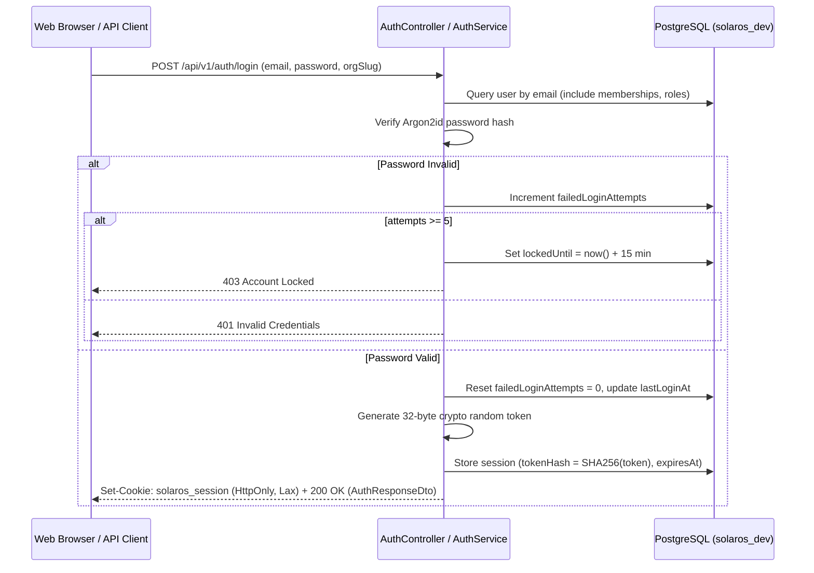

# SolarOS ERP — Authentication Architecture

## 1. Overview
SolarOS ERP employs stateful server-side sessions paired with secure client transports (HttpOnly cookies with fallback to Bearer authorization headers).

## 2. Authentication Lifecycle

## 3. Account Protection Rules
- **Argon2id Hashing**: High computational and memory resistance against GPU/ASIC cracking.
- **Account Lockout**: 5 failed consecutive attempts triggers an automatic 15-minute lock.
- **Password Recovery**: Single-use, time-limited (1 hour) reset tokens stored as SHA-256 hashes. Password reset terminates all active user sessions across all devices immediately.
- **Logout**: Explicit session record revocation in PostgreSQL and immediate cookie clearance.
