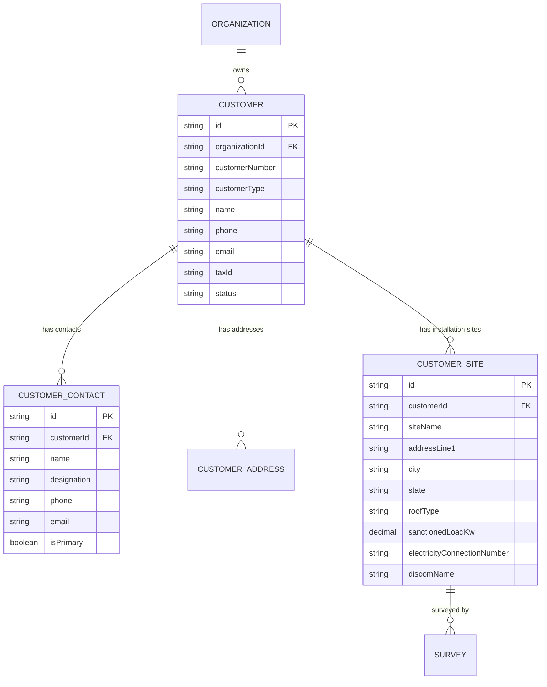

# SOLAROS ERP — CUSTOMER MANAGEMENT SPECIFICATION
## Normalized Schema, Multi-Contact Governance & Site Registry

---

## 1. Domain Objectives

The Customer Management module provides a persistent entity model representing individuals and commercial entities that purchase solar EPC installations, battery systems, or maintenance services.

---

## 2. Entity Relational Architecture

---

## 3. Contact Governance Rules

- Each customer can have multiple authorized contacts (e.g., Managing Director, Site Engineer, Billing Lead).
- The `isPrimary` flag designates the main operational contact for notifications and dispatch.
- When a new contact is designated `isPrimary: true`, all existing contacts for that customer are automatically reset to `isPrimary: false`.

---

## 4. Site Registry

In solar installations, a single customer may own multiple physical installation sites (e.g., a commercial entity with 3 factories, or a residential owner with two properties).
The `CustomerSite` entity encapsulates:
- Physical coordinates (`latitude`, `longitude`)
- DISCOM utility provider details (`discomName`, `electricityConnectionNumber`, `sanctionedLoadKw`)
- Structural rooftop properties (`roofType`, `roofAreaSqFt`, `shadowFreeAreaSqFt`)
- Metering details (`meterNumber`, `averageMonthlyUnits`)
