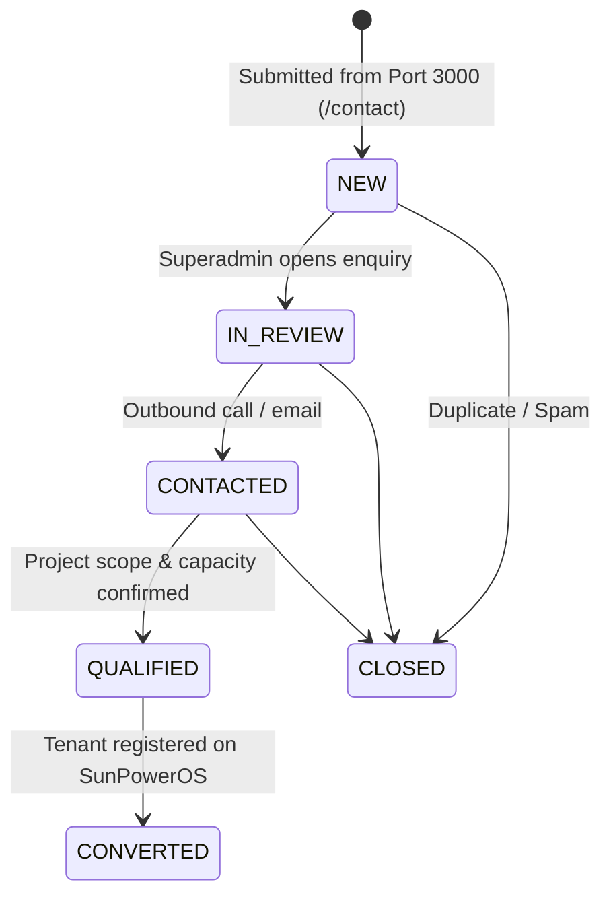

# SunPowerOS — Public Enquiry Integration Verification

## 1. Overview

The SunPowerOS public marketing website on **Port 3000** provides a Contact & Demo Request form at `http://localhost:3000/contact`. When prospective solar clients submit enquiries, they are formatted with standardized numbering (`ENQ-YYYY-XXXXXX`) and channeled into the **Port 3001** Public Website Enquiries Inbox.

---

## 2. Pipeline Stages

---

## 3. Integration Data Structure

Each enquiry record contains:
- **Reference Number**: Unique human-readable document number generated via `NumberingService` (e.g. `ENQ-2026-000007`).
- **Contact Info**: Name, corporate email, phone number, company name.
- **Project Scope**: Estimated capacity (e.g. `1.5 MW Commercial Rooftop`), category (`GENERAL_INQUIRY`, `DEMO_REQUEST`, `ENTERPRISE_SALES`, `PARTNERSHIP`).
- **Assignment**: Assigned Platform Administrator.
- **Internal Notes**: Administrative discussion thread and follow-up history.

---

## 4. Automated Test Verification

Verified in `tests/integration/platform-admin-cross-frontend.spec.ts`:
- Public enquiry submitted on Port 3000: `ENQ-2026-000007`.
- Listed on Port 3001 with search and status filtering.
- Status updated to `QUALIFIED` with internal follow-up notes.
- **Result: Passed in 8 ms.**
