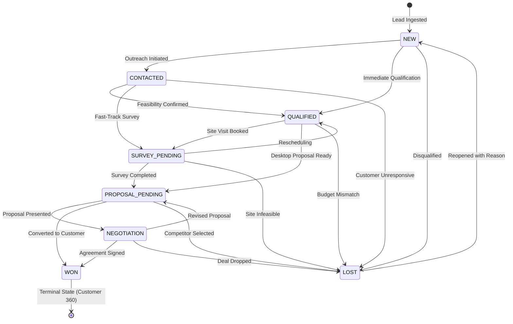

# SOLAROS ERP — LEAD LIFECYCLE STATE MACHINE
## Stage Transition Rules, Invariants & Terminal States

---

## 1. State Machine Definition

The lead lifecycle enforces a strict state machine to prevent premature quotation without technical feasibility.

---

## 2. Transition Rules Matrix

| From Stage | Allowed Target Stages | Rejection Behavior |
| :--- | :--- | :--- |
| `NEW` | `CONTACTED`, `QUALIFIED`, `LOST` | Direct transition to `WON` throws `400 Bad Request` |
| `CONTACTED` | `QUALIFIED`, `SURVEY_PENDING`, `LOST` | Invalid skip throws `400 Bad Request` |
| `QUALIFIED` | `SURVEY_PENDING`, `PROPOSAL_PENDING`, `LOST` | Requires valid lead ID |
| `SURVEY_PENDING` | `PROPOSAL_PENDING`, `QUALIFIED`, `LOST` | Automatically updated upon survey completion |
| `PROPOSAL_PENDING` | `NEGOTIATION`, `WON`, `LOST` | Allows conversion to customer |
| `NEGOTIATION` | `WON`, `LOST`, `PROPOSAL_PENDING` | Allows revision back to proposal |
| `LOST` | `NEW` | Requires `reason` describing why lead is reopened |
| `WON` | *None* | Terminal state (immutable conversion to Customer) |

---

## 3. Lead Qualification Scoring Algorithm

A composite score (0-100) is calculated during lead creation and updated upon parameter changes:
- **Base Score:** 40 points
- **Monthly Electricity Bill:**
  - > ₹5,000 / month: +20 points
  - > ₹2,500 / month: +10 points
- **Roof Area:**
  - > 500 sq.ft.: +15 points
  - > 200 sq.ft.: +10 points
- **Estimated Solar Capacity:**
  - >= 3 kW: +15 points
- **Inquiry Source:**
  - Referral: +10 points
  - Organic Website: +5 points
- **Maximum Cap:** 100 points
