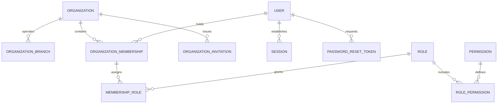

# SolarOS ERP — Phase 0.5 Identity Architecture

## 1. Executive Summary
Phase 0.5 establishes a centralized, enterprise-grade Identity & Access Management (IAM) infrastructure for SolarOS ERP. Rather than having fragmented, module-level authentication or simulated mocks, SolarOS incorporates a single, cryptographically enforced identity layer powering all current and future business modules (CRM, Customers, Surveys, Catalog, Engineering, BOM, Quotations, and Sales Orders).

## 2. Core Architectural Principles
1. **Centralized Identity Core**: Single source of truth for identity, authentication, credential validation, and tenant membership.
2. **Cryptographic Integrity**:
   - Passwords stored as **Argon2id** hashes (OWASP recommended parameters: 19 MiB memory, 2 iterations, 1 parallelism).
   - Opaque 32-byte cryptographically secure random session tokens, stored as **SHA-256** digests in PostgreSQL.
3. **Multi-Tenant Separation**: Enforced via PostgreSQL `FORCE ROW LEVEL SECURITY` with non-superuser role `solaros_app`.
4. **Declarative RBAC & Record-Level Scopes**: Fine-grained `@RequirePermissions(...)` decorators backed by `AuthenticationGuard`, `TenantContextGuard`, and `PermissionsGuard`.

## 3. Data Model Hierarchy

## 4. Key Components
- **`IdentityModule` (`@Global`)**: Exposes `AuthService`, `SessionService`, `PasswordService`, `UsersService`, and guards.
- **`AccessControlModule` (`@Global`)**: Exposes `AccessControlService` and `PERMISSION_REGISTRY`.
- **`OrganizationsModule`**: Manages company profiles, branch locations, and employee invitations.
