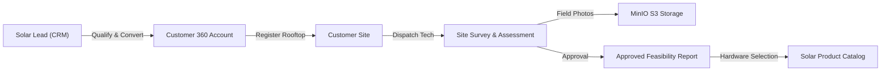

# SOLAROS ERP — PHASE 1 ARCHITECTURE SPECIFICATION
## Commercial Core: CRM, Customer 360, Site Survey & Solar Catalog

---

## 1. System Overview

Phase 1 establishes the complete commercial engineering and sales foundation of SolarOS ERP. It provides end-to-end capabilities spanning initial solar customer inquiry capture, qualification scoring, lead-to-customer conversion, field feasibility site surveys, photograph evidence capture with signed object storage URLs, and solar product catalog management with variant-level price histories.

---

## 2. Domain Decomposition

Phase 1 implements 4 major domain modules in `apps/api/src/modules/` and corresponding ERP frontends in `apps/web/src/app/(erp)/`:

| Domain Module | Primary Responsibilities | Entities / Tables | Key API Route |
| :--- | :--- | :--- | :--- |
| **CRM & Leads** | Lead capture, lifecycle state machine, qualification scoring, duplicate detection, conversion | `leads`, `lead_activities`, `lead_status_history` | `/api/v1/crm/leads`, `/api/v1/crm/analytics` |
| **Customers (360)** | Account governance, multi-contact management, billing addresses, installation sites, unified activity timeline | `customers`, `customer_contacts`, `customer_addresses`, `customer_sites` | `/api/v1/customers`, `/api/v1/customers/:id/360` |
| **Site Surveys** | Technician dispatch, rooftop geometry, electrical grid feasibility, MinIO presigned photo upload, revision tracking, printable PDF reports | `surveys`, `survey_revisions`, `survey_photos` | `/api/v1/surveys`, `/api/v1/surveys/:id/report` |
| **Solar Catalog** | Categories, manufacturers/OEMs, products (panels, inverters, batteries), variants, technical attribute values, price history | `product_categories`, `manufacturers`, `products`, `product_variants`, `product_attribute_definitions`, `product_attribute_values`, `product_price_history` | `/api/v1/catalog/products`, `/api/v1/catalog/variants/:id/price` |

---

## 3. Multi-Tenancy & Row-Level Security (RLS)

All 17 Phase 1 database tables enforce database-level tenant isolation:
- Every table includes an indexed `organizationId` column.
- PostgreSQL executes `ALTER TABLE "<table>" FORCE ROW LEVEL SECURITY;`.
- Tenant context is set per transaction using `SET LOCAL app.current_organization_id = '<tenant_uuid>'` via `PrismaService.forTenant(...)`.
- Cross-tenant queries are blocked at the database engine level (error code `42501`).
- Super admin bypass is available via `app.is_super_admin = 'true'` for platform-wide operations.

---

## 4. Object Storage Architecture

- Object storage utilizes native MinIO S3 API on port 9000.
- Photos are never streamed through the API server memory.
- The browser requests a presigned PUT URL via `POST /api/v1/surveys/:id/photos/upload-url`.
- The frontend uploads binary data directly to MinIO.
- The upload is confirmed via `POST /api/v1/surveys/:id/photos/confirm`.
- Download URLs are generated on demand with a 3600-second signature expiry.
