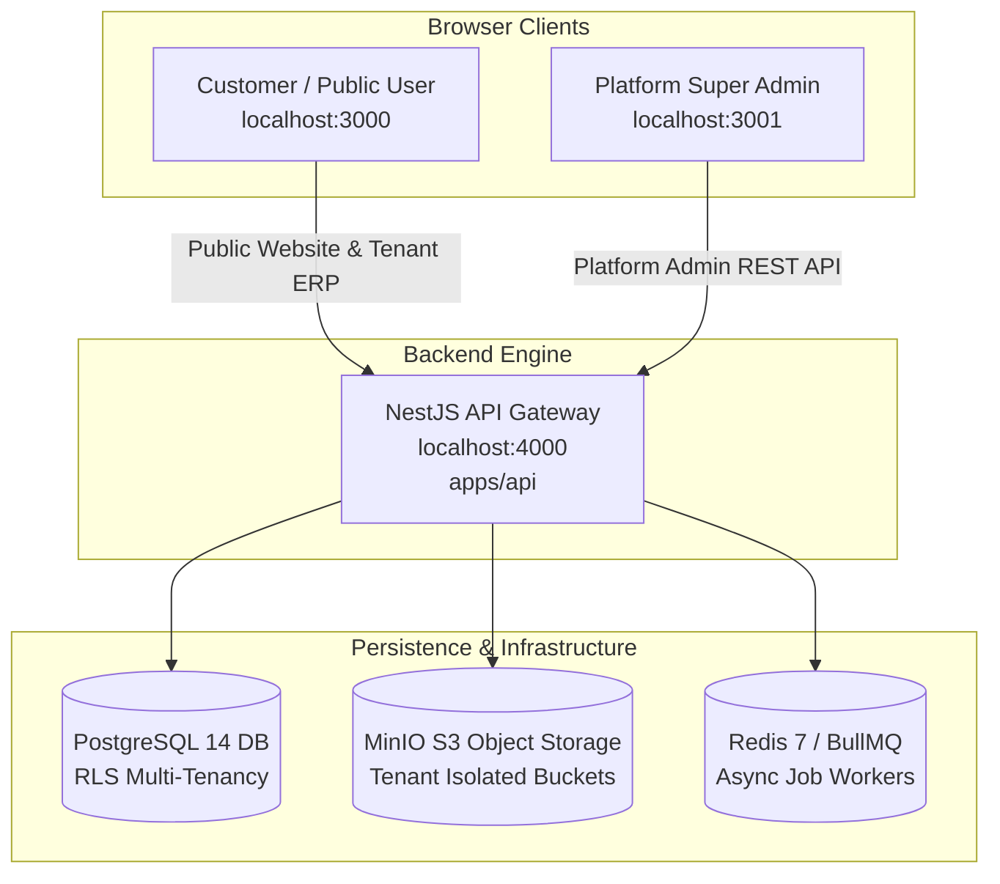

# SunPowerOS — Platform Admin Frontend Separation Architecture

## 1. Executive Summary

SunPowerOS is an enterprise multi-tenant SaaS platform tailored for solar engineering, procurement, and construction (EPC) companies. Prior to this architectural milestone, administrative and platform monitoring interfaces co-existed under `apps/web` alongside the public marketing site and tenant ERP workspaces.

In this architectural separation:
1. **Existing Web & Customer ERP** remains strictly preserved on **Port 3000** (`apps/web`).
2. **Platform Admin Control Center** has been extracted into an autonomous, isolated Next.js application on **Port 3001** (`apps/platform-admin`).
3. **Shared NestJS API** operates on **Port 4000** (`apps/api`), serving both frontends through unified CORS policies, role-based authorization, and PostgreSQL row-level security (RLS).

---

## 2. System Topology

---

## 3. Package Structure

| Path | Package Name | Port | Target Audience | Primary Function |
| :--- | :--- | :--- | :--- | :--- |
| `apps/web` | `@solaros/web` | `3000` | Public Visitors & Solar EPC Tenants | Marketing site, self-service onboarding, CRM, Design/BOM, Quotes, Procurement, Inventory, Installation Handover |
| `apps/platform-admin` | `@solaros/platform-admin` | `3001` | SunPower Solutions Internal Operators | Tenant 360, Global User Directory, Enquiries Inbox, Support Desk, SaaS Analytics, Infrastructure Health & Alerts |
| `apps/api` | `@solaros/api` | `4000` | All Applications | Centralized REST API with dual-CORS, RLS multi-tenant execution, and superadmin authorization |

---

## 4. Key Architectural Guarantees

1. **Zero Tenant ERP Regressions**: No routes, components, or services under `apps/web` (`localhost:3000`) were modified, removed, or compromised. The entire 8-stage solar EPC lifecycle functions exactly as before.
2. **Zero Cross-Talk Leaks**: Platform admin privileges cannot be acquired or manipulated from Port 3000. Superadmin API tokens are strictly isolated in separate local storage keys (`solaros_platform_token`) and validated against `isSuperAdmin = true`.
3. **CORS Dual-Whitelisting**: `apps/api/src/main.ts` permits origins matching `^http:\/\/localhost:(3000|3001)$` with credentials enabled, preventing cross-origin blockages during local development while strictly denying unauthorized external origins.
4. **Clean Port 3000 Redirect**: Legacy `/platform-admin` routes on Port 3000 automatically navigate to `http://localhost:3001/overview`, eliminating duplicate UI surfaces.
