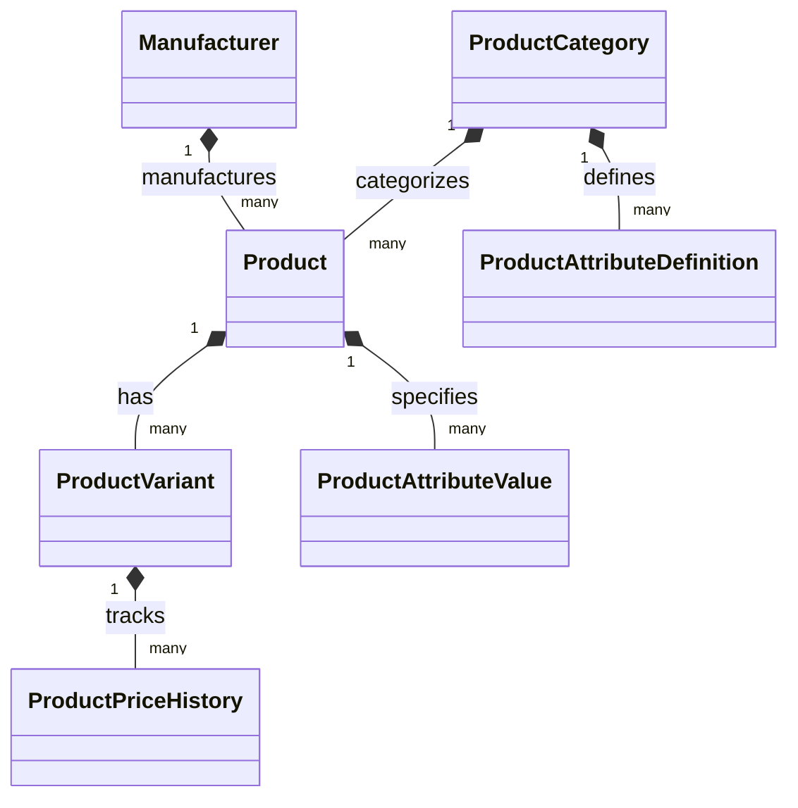

# SOLAROS ERP — SOLAR PRODUCT CATALOG SPECIFICATION
## Normalized Hierarchy, Variant Matrix, Technical Specifications & Price History

---

## 1. Purpose

The Solar Product Catalog module serves as the commercial master for all physical hardware components utilized in solar projects. It handles solar panels, string/micro inverters, energy storage batteries, mounting structures, and balance of system (BOS) accessories.

---

## 2. Entity Hierarchy

---

## 3. Precision Pricing & Audit Trail

Solar module and inverter prices fluctuate dynamically based on silicon wafer costs, global shipping, and foreign exchange rates.
- Prices are stored as `Decimal(12, 2)` to eliminate floating-point rounding errors.
- Every variant has current `costPrice` and `sellingPrice`.
- When a price is modified via `PATCH /api/v1/catalog/variants/:id/price`:
  1. The active `ProductPriceHistory` record is closed (`effectiveTo = NOW()`).
  2. A new `ProductPriceHistory` record is inserted with `effectiveFrom = NOW()`, new prices, `changedById`, and documented `reason`.
  3. The `ProductVariant` active prices are updated.

---

## 4. Dynamic Technical Specification Attributes

Different solar equipment types require distinct technical attributes:
- **Solar Modules:** Open-Circuit Voltage ($V_{oc}$), Short-Circuit Current ($I_{sc}$), Max Power Voltage ($V_{mp}$), Max Power Current ($I_{mp}$), Module Efficiency (%), Cell Type (Mono PERC, TopCon, HJT).
- **Inverters:** Nominal AC Power (kW), Max DC Input Voltage (V), MPPT Operating Range (V), Number of MPPTs, Max Efficiency (%).
- **Batteries:** Nominal Capacity (kWh), Chemistry (LFP / NMC), Cycle Life, Depth of Discharge (DoD), Max Continuous Discharge Current (A).

The catalog implements dynamic attribute definitions (`ProductAttributeDefinition`) per category with typed values (`ProductAttributeValue`) without requiring schema migrations for new specifications.
