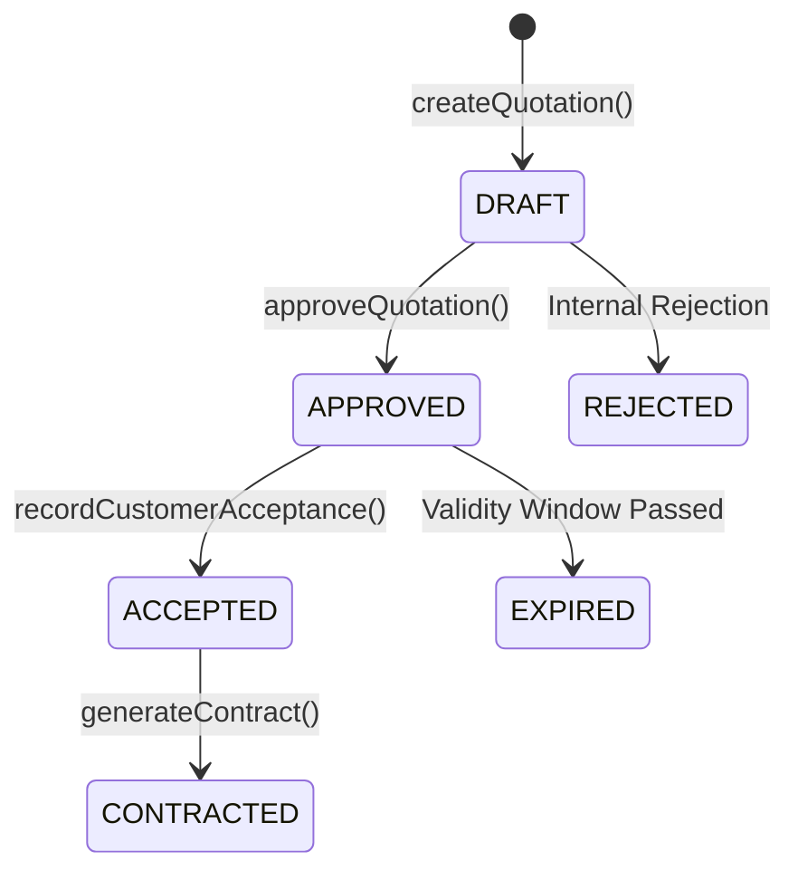

# SolarOS Quotation Lifecycle & Customer Acceptance

## 1. Quotation Lifecycle State Machine

## 2. Validation & Security Rules

1. **Approved BOM Mandatory:** A quotation cannot be generated from an unapproved BOM.
2. **Sequential Revision Control:** Re-running pricing or modifying discount bumps the quotation version (`v1` $\to$ `v2`) while preserving previous quote records.
3. **Acceptance Verification:** Recording customer acceptance requires:
   - Acceptance Channel (`DIGITAL_SIGNATURE`, `SIGNED_PHYSICAL_COPY`, `OTP`, `EMAIL_CONFIRMATION`).
   - Customer signatory legal name.
   - Optional evidence URL (MinIO storage object key).
