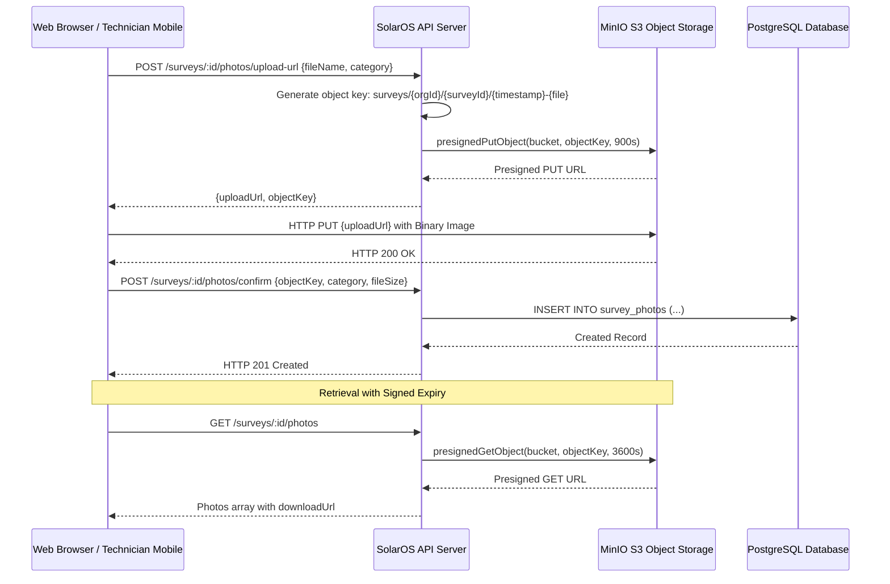

# SOLAROS ERP — OBJECT STORAGE INTEGRATION
## MinIO Presigned URLs, Direct Browser Upload & Signed Retrieval

---

## 1. Storage Architecture

SolarOS uses S3-compatible object storage (MinIO locally, AWS S3 / Google Cloud Storage in production).
Large binary files (site survey photos, drone orthomosaic maps, electrical single-line diagrams, engineering CAD files) must never stream through application server RAM.

---

## 2. Bucket Taxonomy

Configured in `@solaros/config` (`STORAGE_BUCKETS`):
- `solaros-documents`: Formal PDF contracts, invoices, subsidy sanction letters.
- `solaros-surveys`: Field inspection photos, roof azimuth compass photos, switchboard meters.
- `solaros-assets`: Solar module datasheets, inverter manuals, company branding.

---

## 3. Upload & Retrieval Sequence

