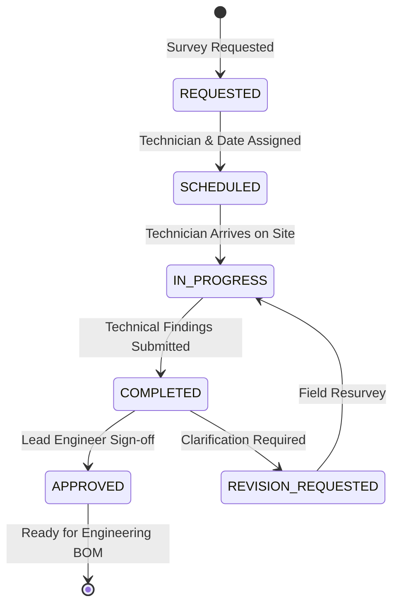

# SOLAROS ERP — SITE SURVEY WORKFLOW & AUDIT
## Dispatch, Field Assessment, Photograph Evidence & Approval Lifecycle

---

## 1. Survey Lifecycle States

---

## 2. Versioned Survey Revisions (`SurveyRevision`)

To maintain engineering auditability:
- Whenever a survey assessment is submitted or updated, a snapshot is captured in `survey_revisions`.
- Fields captured: `surveyId`, `revisionNumber`, `changesSummary`, `dataSnapshot` (JSON), `createdById`, `createdAt`.
- When an engineer requests revisions, the survey's `currentRevisionNumber` increments, ensuring historical versions remain accessible for dispute resolution.

---

## 3. Photograph Evidence Workflow

1. Technician accesses the survey on mobile web or tablet.
2. Selects category (`ROOF`, `METER`, `MAIN_SWITCHBOARD`, `INVERTER_LOCATION`, `OBSTACLE`, `STRUCTURE`).
3. Browser calls `POST /api/v1/surveys/:id/photos/upload-url` receiving a presigned PUT URL directly to MinIO.
4. Binary photo is transferred directly to MinIO.
5. Client calls `POST /api/v1/surveys/:id/photos/confirm` creating `SurveyPhoto` record.
6. When viewing, signed GET URLs are generated with 3600-second expiration.

---

## 4. Printable Feasibility Report

`GET /api/v1/surveys/:id/report` compiles:
- Customer and site demographics.
- Feasibility parameters and recommended capacity.
- Grid interconnect specifications.
- Embedded photo evidence cards with signed download URLs.
- Engineering approval status and timestamp.
