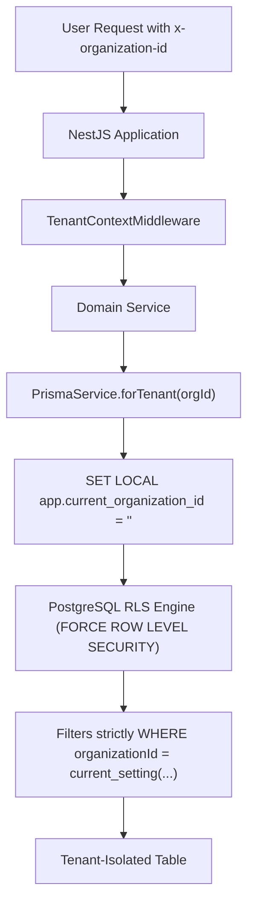

# SOLAROS ERP — TENANT ISOLATION & RLS VERIFICATION
## Database Engine Multi-Tenancy Security & Test Proof

---

## 1. Multi-Tenancy Architecture

SolarOS employs a pooled database, shared-schema multi-tenant architecture with PostgreSQL Row-Level Security (RLS) enforcement.



---

## 2. Row-Level Security Enforcement Script

Script: `database/sql/rls-policies/002_phase1_tenant_isolation.sql`
Every Phase 1 table is configured with:
```sql
ALTER TABLE "<table>" ENABLE ROW LEVEL SECURITY;
ALTER TABLE "<table>" FORCE ROW LEVEL SECURITY;

CREATE POLICY tenant_isolation_<table> ON "<table>"
  FOR ALL
  USING (
    "organizationId" = current_setting('app.current_organization_id', true)
    OR current_setting('app.is_super_admin', true) = 'true'
  )
  WITH CHECK (
    "organizationId" = current_setting('app.current_organization_id', true)
    OR current_setting('app.is_super_admin', true) = 'true'
  );
```

---

## 3. Verification Test Evidence

The automated test suite `tests/integration/phase1-rls-tenant-isolation.spec.ts` connects via the non-superuser role `solaros_app` and executes real database assertions:

1. **Positive Isolation:** Tenant A queries Tenant A records $\to$ Records returned successfully.
2. **Negative Isolation:** Tenant B queries Tenant A records $\to$ Returns `null` / empty set (PostgreSQL kernel blocks row transmission).
3. **Write Protection:** Tenant B attempts to insert row with Tenant A's `organizationId` $\to$ PostgreSQL throws error code `42501` (`new row violates row-level security policy`).
4. **Super Admin Bypass:** Platform operations with `app.is_super_admin = 'true'` $\to$ Access granted across tenants for system maintenance.
